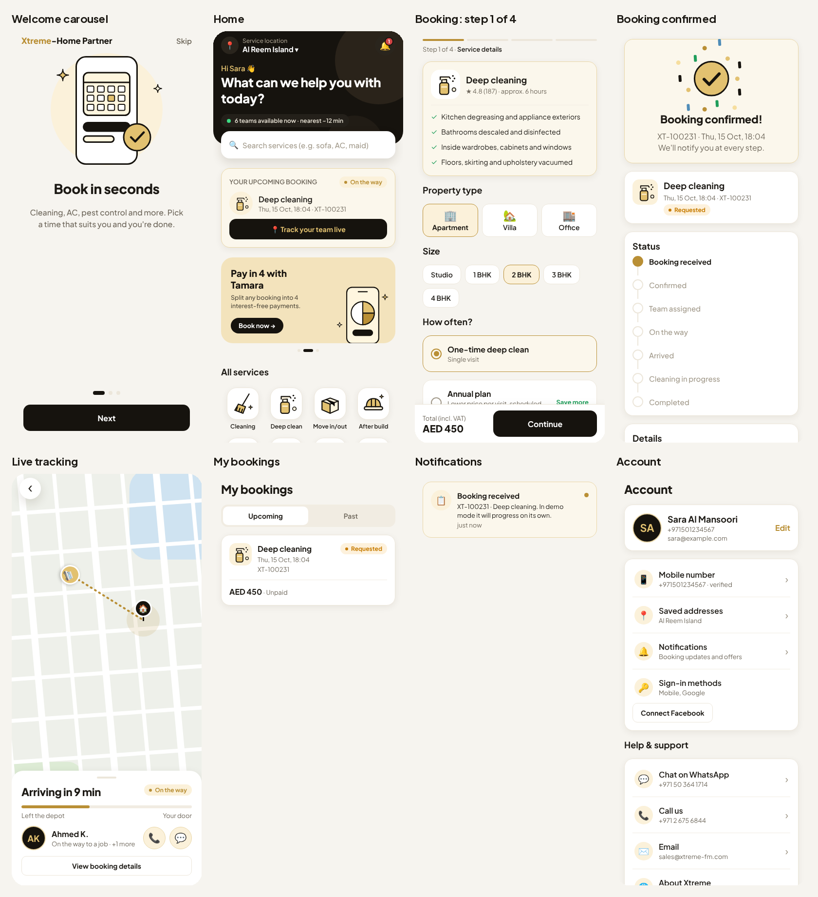

# Xtreme-Home Partner

**Xtreme-Home Partner** is the Xtreme Facilities Management app for iPhone and Android. Customers book any Xtreme service in a few taps, pay by card, Apple Pay, Google Pay or Tamara, and watch their team arrive live on a map. Staff use the same app to go on duty, receive jobs and update each job's status.




| Folder | What it is |
| --- | --- |
| [`backend/`](backend) | The API: sign-in, bookings, dispatch, live tracking, payments, notifications. Node.js 22, Fastify, PostgreSQL, Socket.IO. |
| [`mobile/`](mobile) | The app for the App Store and Google Play, built with Expo (React Native). |
| [`backend/admin/`](backend/admin) | **Xtreme Dispatch**, the office dashboard at `/admin`: dispatch board, team assignment, live staff map, staff and payments. |
| [`docs/GO_LIVE.md`](docs/GO_LIVE.md) | **Step-by-step production launch** (server, dashboard, store builds). |
| [`docs/SETUP_CHECKLIST.md`](docs/SETUP_CHECKLIST.md) | **The accounts and keys the business owner needs to create before launch.** |

## What the app does

**Customers**
- Sign in with a mobile number (SMS code), Google, Facebook or Apple. Several methods can be linked to one account.
- Browse all 16 Xtreme services with the official price list (AED, VAT included). Services priced after a survey show "Free survey".
- Book: property type and size, date and time, address chosen on a map, notes.
- Pay by card, Apple Pay or Google Pay (Stripe), in 4 instalments with Tamara, or on the day. Cancelling a paid booking refunds it automatically.
- See how many Xtreme teams are on duty, available and deployed right now, and how far the nearest available team is.
- Once a team is assigned: see who is coming and their status. While they drive over: see their live position on the map with an ETA.
- Push notifications at every step, booking history, ratings, saved addresses, account deletion.

**Staff** (same app, shown automatically for staff accounts)
- Go on or off duty, or take a break. Location is shared only while on duty.
- See assigned jobs, call the customer, open navigation, and tap through *Start driving → Arrived → Start job → Completed*.

**Office** (admin API, ready for a dispatch dashboard)
- Confirm bookings, assign teams, set prices after a survey, issue refunds, view every team member's live position and route history, suspend accounts.

## Quick start (developers)

```bash
cd backend
cp .env.example .env
docker compose up -d db redis
npm install
npm run db:migrate
npm run db:seed        # makes ADMIN_PHONE an admin
npm run dev            # API on :8080, docs on http://localhost:8080/docs
npm test

cd ../mobile
npm install
npx expo run:ios       # or run:android; needs Xcode / Android Studio
```

With `SMS_PROVIDER=console` the sign-in codes are printed in the API log.

## Android test APK

Every push that changes `mobile/` builds an installable APK on GitHub Actions (`.github/workflows/android-apk.yml`) and publishes it on the **Releases** page as **"Android test build"** (`Xtreme-Home-Partner-test.apk`). To install: open that page on an Android phone, download the APK, open it and allow installing from your browser.

The test APK runs in **demo mode** with built-in sample data, so it needs no server:
- any mobile number and any 6-digit code sign you in (`050 000 0002` opens the staff app);
- a new booking moves by itself: confirmed after ~6 s, team assigned, then on the way at ~18 s with the van driving to you on the map, arrived, in progress and completed after ~2 minutes;
- payments are simulated (no real card is charged).

To build against a real server instead, run the workflow manually (Actions → android-apk → Run workflow) with `demo = false` and your API URL.

## Design

The look follows the home-services apps customers already know (Justlife, ServiceMarket, Urban Company and others): a light, clean layout with the Xtreme black and gold as accents, the area and a search bar at the top of the home screen, an offers carousel, a service icon grid, "most booked" cards with ratings and prices, a 4-step booking flow with a fixed price bar, and a map with a bottom sheet for live tracking. Type is Plus Jakarta Sans.
